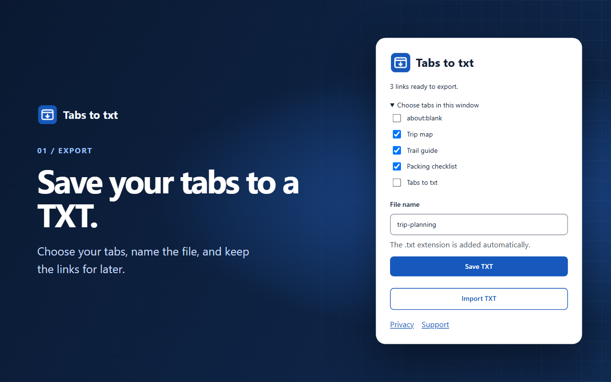
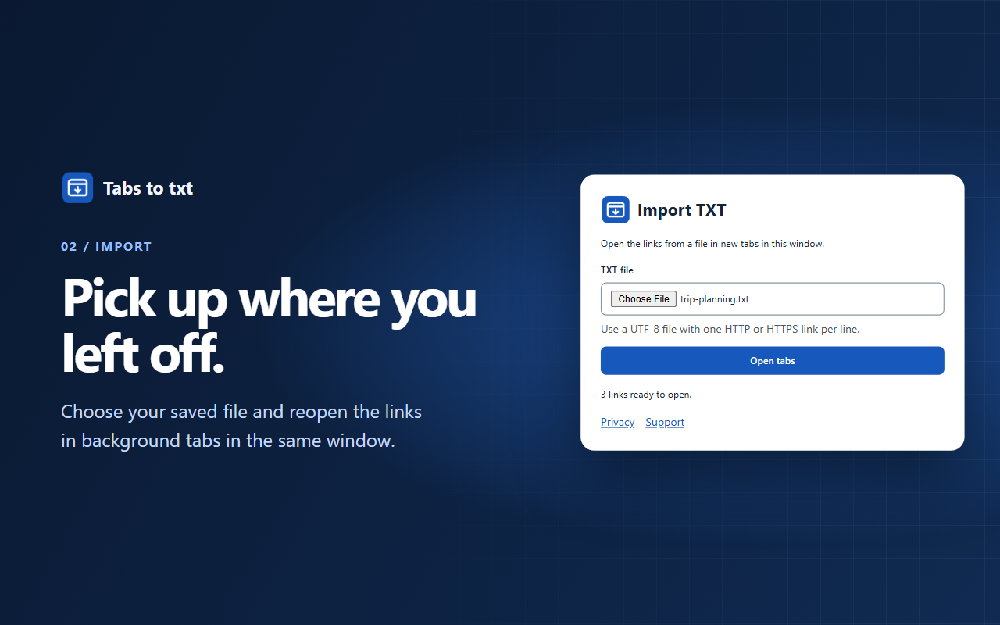

# Tabs to txt

Tabs to txt is a browser extension for exporting selected tab URLs to a portable TXT file and restoring saved URLs as browser tabs.

Files use UTF-8 with one URL per line. Tab information and file contents are processed locally.



## Features

- Export selected tabs with a custom file name.
- Preserve tab order and duplicate URLs.
- Restore saved HTTP and HTTPS links in background tabs in the same window.
- Edit saved lists with any text editor.

## Export tabs

1. Select tabs in the browser's tab bar, or expand **Tab selection** in the extension popup.
2. Enter a **File name**.
3. Select **Export TXT**.

The file contains the selected URLs in tab order. The `.txt` extension is added automatically.

## Import tabs

1. Select **Import TXT** in the popup.
2. Select a saved TXT file.
3. Confirm the number of valid URLs and select **Open tabs**.

Valid URLs open in background tabs in the same window. Blank lines are ignored, and invalid or unsupported entries are reported. If a tab cannot be opened, a subsequent attempt retries only the remaining URLs.



## File format

TXT files contain one URL per line in UTF-8. Import supports HTTP and HTTPS addresses.

```text
https://example.com/
https://example.org/
https://example.net/
```

A [sample TXT file](store/sample-tabs.txt) is included.

## Manual installation

Download the source archive through **Code → Download ZIP** and extract its contents.

- **Chrome, Edge, and Brave.** Open `chrome://extensions`, `edge://extensions`, or `brave://extensions`. Turn on **Developer mode**, click **Load unpacked**, and select the extracted folder containing `manifest.json`.
- **Firefox.** Open `about:debugging#/runtime/this-firefox`, select **Load Temporary Add-on**, and select `manifest.json`. The temporary installation ends when Firefox restarts.

Safari requires a separate extension package and website access permissions. Compatibility with Safari on macOS is under validation.

## Privacy

Tab URLs, titles, and TXT files are processed on the device. The extension requires no account and includes no advertising or telemetry. Imported URLs are opened through the browser's normal navigation process.

[Privacy Policy](https://almeida-paulo.github.io/tabs-to-txt/privacy.html) · [Product support](https://almeida-paulo.github.io/tabs-to-txt/support.html)

## Feedback and support

Feature requests and bug reports are available through [GitHub Issues](https://github.com/Almeida-Paulo/tabs-to-txt/issues/new/choose).

Technical support and privacy inquiries can be sent to [contato.tabstotxt@midnorth.com.br](mailto:contato.tabstotxt@midnorth.com.br).

## Acknowledgments

Codex was used to assist in the development of this application.
